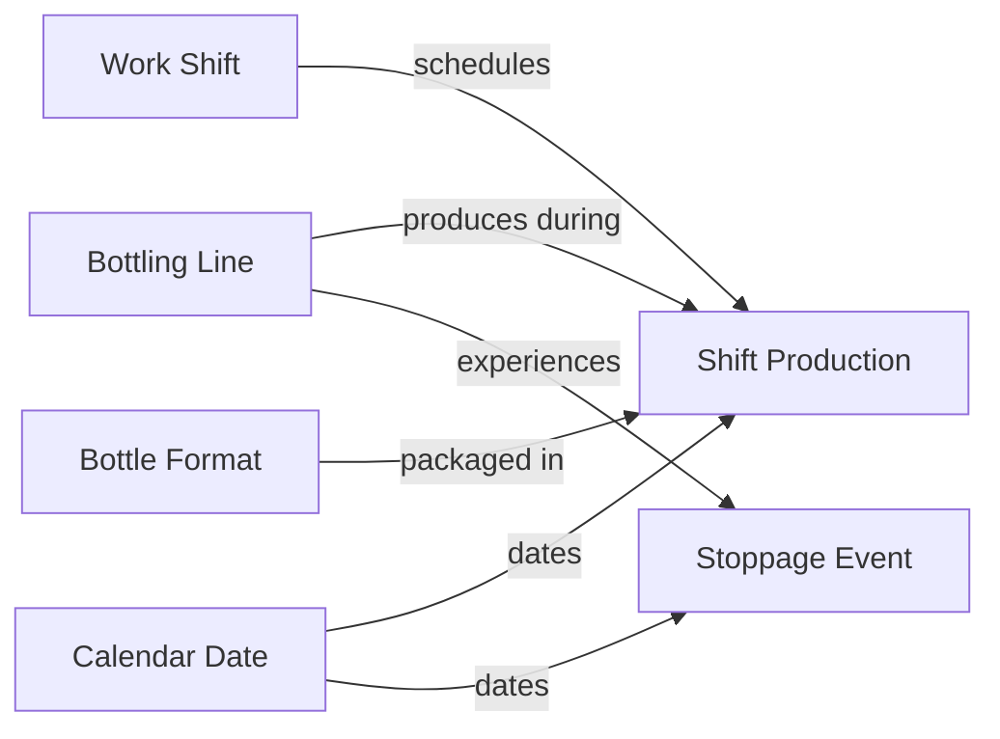

# Course: Business Intelligence and Big Data Analysis (`01 31 0367 00`)

## Academic & Technical Synthesis — Lecture 04: Data Modeling, Kimball Star Schemas & Introduction to Analytical SQL

**Language:** English (`EN`)  
**Instructor:** Tomasz Kołodziejczyk (IFE, 2026)  
**Audience:** 4th Year B.Sc. Engineering (Management and Production Engineering)  
**Session Duration:** `90 Minutes` *(Flows directly into **Lab 05** today and prepares squads for **Tutorial #2** project modeling)*  
**Data Pipeline Context (Medallion Architecture):** `1. Source Data` → `2. Bronze Layer` → `3. Silver Layer` → **`4. Gold Layer (Dimensional Warehouse)`** → `5. BI & Analytics`

---

## 0. Session Roadmap & Running Industrial Story (`90 min`)

In **Lecture 03**, we cleaned dirty factory streams and built a trustworthy **Silver Layer**. Today we cross the bridge into the **Gold Layer**: turning clean tables into an analytical **Data Warehouse** that answers boardroom questions in milliseconds—without double-counting capacity or misleading executives.

We will follow **one continuous factory story** from start to finish—**EuroPack Beverage Bottling (Plant #1, Gdańsk)**—and watch the *exact same shopfloor data* evolve from whiteboard sketches into live **DuckDB SQL** queries:

| Block | Time | Topic | Takeaway for Today's Lab 05 & Upcoming Tutorial #2 |
| :--- | :---: | :--- | :--- |
| **Block 1** | `00:00 – 00:25` *(25m)* | **Conceptual → Logical → Physical Modeling** | How to go from business questions to a blueprint (your exact **Tutorial #2** workflow!). |
| **Block 2** | `00:25 – 00:35` *(10m)* | **Data Warehouse Design Patterns** | Why modern industrial BI pairs **Medallion Silver** with a **Kimball Gold Star Schema**. |
| **Block 3** | `00:35 – 01:05` *(30m)* | **Kimball Star Schema Deep Dive** | 4-Step Design, Grain, Additivity, Surrogate Keys & the **Fan-Out Trap** (`31.9×` error!). |
| **Block 4** | `01:05 – 01:30` *(25m)* | **"SQL as English" for Star Schemas** | Reading & writing `SELECT`, `WHERE`, `GROUP BY`, `INNER/LEFT JOIN` — your launchpad into **Lab 05**. |

---

## 1. Block 1 (`00:00 – 00:25`): From Factory Floor to Database — Conceptual, Logical & Physical Models

Before writing a single line of SQL, industrial engineers draw blueprints. You would never weld a conveyor frame without a CAD drawing; similarly, you should never load a Data Warehouse without **three progressive layers of data modeling**.

```text
  LEVEL 1: CONCEPTUAL              LEVEL 2: LOGICAL                  LEVEL 3: PHYSICAL
  (Business Boardroom)             (Data Architect / DBML)           (DuckDB / Parquet Engine)
  ────────────────────             ───────────────────────           ─────────────────────────
  "What business concepts          "What are the exact tables,       "What exact SQL types,
   exist and how do they            grain, Primary/Foreign Keys,      indexes, surrogate keys &
   relate?"                         and cardinalities (1:N)?"         storage formats do we run?"
        │                                    │                                  │
        ▼                                    ▼                                  ▼
   Boxes & Verbs                     ERD / DBML Diagram                CREATE TABLE ... AS SELECT
  (Tool: Whiteboard)                (Tool: dbdiagram.io)              (Tool: DuckDB + Parquet)
```

### 1.1 Level 1 — The Conceptual Data Model (*What Does the Business Care About?*)
* **Audience:** Plant Director (COO), Head of Maintenance, Supply Chain Manager — **zero IT jargon!**
* **Contains ONLY:** High-level **Business Entities** (nouns) and **Relationships** (verbs). No data types, no surrogate keys, no `VARCHAR(50)`.
* **EuroPack Bottling Example:**
  * A **Bottling Line** *produces* **Bottle Formats** during a **Work Shift** on a given **Calendar Date**.
  * A **Bottling Line** *experiences* **Stoppage Events** handled by a **Technician Team**.



> **Tutorial #2 Connection:** When your squad starts modeling **SmartPress**, **DataCo**, or **Nexis**, begin here! If the Plant Director cannot point at your Conceptual Model and say *"Yes, that is how our factory works,"* stop and fix it before touching a computer.

### 1.2 Level 2 — The Logical Data Model (*What Data Exists — Business Keys & Relationships*)
* **Audience:** Business Analysts, Domain Experts & Data Architects (**platform- and pattern-independent** — documents *what data exists* in business terms before choosing whether the warehouse will be 3NF, Data Vault, or a Kimball Star Schema!).
* **Adds four critical details (documented as an ER Diagram + ISO Data Dictionary in Tutorial #2):**
  1. **Exact Business Attributes:** e.g., `bottled_units`, `rejected_units`, `downtime_min`, `hourly_operating_cost_eur`.
  2. **Natural / Business Keys (`PK`):** The business identifier that uniquely names one real entity (e.g., `line_id = 'LINE_B'`, `shift_code = 'S3'`, `format_id = 'PET_05'`, `log_id = 'STOP-021'`).
  3. **Relationships & Foreign Keys (`FK`):** How business events connect to reference entities.
  4. **Cardinality & Optionality (`1:N` / `1:1` / `M:N`):** How many instances on one side match the other!
     * `Bottling Line` (`1`) ───► (`N`) `Shift Production`: *One bottling line runs many shifts, and each shift belongs to exactly one bottling line (mandatory bar `|`).*
     * **Red Flag (`M:N`):** Many-to-Many relationships between two operational entities (e.g., 15-minute sensor telemetry linked directly to multiple shift stoppages) are the **#1 cause of silent metric inflation**!

### 1.3 Level 3 — The Physical Data Model (*Warehouse Blueprint in DBML → Implementation in DuckDB*)
* **Audience:** Data Architects, Data Engineers & BI Developers.
* **Translates the Logical Model into a concrete Data Warehouse architecture (here: Kimball Star Schema in DuckDB):**
  * **Physical Blueprint (`schema.dbml`):** The Data Architect's CAD tool designing *how* the Logical Model will be implemented in the warehouse — choosing the **Kimball Star Schema** (`Dim_*` & `Fact_*` tables), replacing messy natural codes with integer **Surrogate Keys** (`line_key [pk]`), declaring concrete data types (`integer`, `double`, `varchar`, `timestamp`), and enforcing mandatory foreign keys (`[not null, ref: > Dim_...]`).
  * **Running Database Engine (`europack_lab05.duckdb` + Parquet):** Exact `CREATE TABLE` SQL DDL, Snappy-compressed Parquet storage, and governed KPI views implementing `schema.dbml` 1-to-1.

### 1.4 Why Build a DBML? The Data Architect's CAD Blueprint
Students often ask: *"How do the Logical Model, Kimball Star Schema, and DBML fit together?"* Think of three distinct roles:
* **Logical Model** = *What business data exists* (attributes, natural keys, relations — readable by the business; ER diagram + `data_dictionary_template.md`).
* **Kimball Star Schema** = *The warehouse design pattern* chosen by the Data Architect (Facts + Conformed Dimensions + Surrogate Keys — covered in Blocks 2–3!).
* **DBML (`schema.dbml`)** = *The Data Architect's CAD notation* encoding that Physical Kimball Star Schema blueprint before running SQL in DuckDB:
1. **Catch Modeling Bugs in 2 Minutes, Not 2 Hours:** Spotting a missing `Dim_Date`, a reversed `1:N` arrow, or a non-additive `oee_pct` in a visual diagram takes seconds—fixing it after writing 200 lines of SQL takes hours.
2. **Team Alignment Contract (Tutorial #2 → Labs 05–09):** Maps your Logical Data Dictionary to exact physical `Dim_*`/`Fact_*` table names, column names, surrogate keys, and types *before* anyone writes SQL or dashboard code.
3. **Direct 1-to-1 Translation into DuckDB:** Every `Table Dim_Line { ... }` block in `schema.dbml` becomes a real `CREATE TABLE Dim_Line AS ...` table in DuckDB—and keeping **`DBML == DuckDB`** in sync is a core part of your project audit!
4. **Enforces Mandatory Star Links (`NOT NULL`):** In a Kimball Star Schema, every Fact row must belong to a valid Date, Shift, Line, and Format—so DBML encodes `[not null, ref: > Dim_...]` on every Fact foreign key (zero orphan/NULL links).

| Modeling Level | Main Question Answered | Key Elements | Example Artifact | Where You Build It |
| :--- | :--- | :--- | :--- | :--- |
| **1. Conceptual** | *What happens in the business?* | Business Entities (Nouns) + Verbs | Whiteboard / Miro sketch | **Tutorial #2** (Project) |
| **2. Logical** | *What data exists & how does it relate?* | Attributes, Natural/Business Keys, `1:N`/`M:N` relations | Business ER Diagram + **Data Dictionary** | **Tutorial #2** (`data_dictionary_template.md`) |
| **3. Physical (Blueprint → Engine)** | *How do we implement it in the DWH?* | **Kimball Star** (`Dim_*`/`Fact_*`), Surrogate Keys, SQL Types, DDL & Parquet | **DBML (`schema.dbml`)** → **DuckDB** (`europack_lab05.duckdb`) | **Tutorial #2** & **Labs 05–06** |

---

## 2. Block 2 (`00:25 – 00:35`): Data Warehouse Design Patterns — Picking the Right Architecture

Once Silver data is clean, how should an enterprise organize its analytical database? Four major patterns dominate industry practice. As future Production & Management Engineers, you don't need to memorize every theoretical nuance—you need to know **when to pick which pattern**:

| Pattern | Core Idea | Best Strength | Main Weakness | Ideal Use Case |
| :--- | :--- | :--- | :--- | :--- |
| **1. Inmon (3NF / Corporate Information Factory)** | Enterprise-wide highly normalized (`3NF`) relational hub first, then departmental data marts. | Eliminates duplicate attributes; strong top-down enterprise governance. | Slow to build; complex queries requiring 8–12 joins; steep curve for business users. | Massive regulated banks / telecoms with decade-long enterprise IT budgets. |
| **2. Kimball (Dimensional Star Schema)** | Business-process **Fact** tables surrounded by denormalized **Dimension** tables (`1-hop joins`). | **Fastest to understand & query**; maps directly to Power BI / Tableau / Streamlit slicers; incremental delivery. | Requires careful discipline on **Grain** and **Conformed Dimensions** across processes. | **Industrial BI, Manufacturing OEE, Supply Chain & Executive Dashboards (Our Gold Layer!).** |
| **3. Data Vault 2.0** | Splits data into **Hubs** (business keys), **Links** (relationships), and **Satellites** (history). | Audit-proof historical tracking across dozens of changing ERP/MES sources. | Too many joins for direct BI reporting (still requires a Kimball Star Schema on top!). | High-compliance raw integration layers in large multi-plant conglomerates. |
| **4. One Big Table (OBT) / Flat Serving** | Pre-join everything into one wide denormalized table (often exported as Parquet). | Zero joins at query time; blazing fast for a single dashboard page or ML model. | Breaks down when multiple grains exist (e.g., shift production + stoppage events → fan-out!). | Final **BI Serving Export (Lab 07)** built *from* governed Gold views. |

> **Our Industrial Architecture Choice (Medallion + Kimball):**  
> We use **Medallion (Bronze → Silver)** for raw auditability and data quality gates, **Kimball Star Schema** in **Gold (DuckDB)** as our single source of analytical truth, and flat **OBT Serving Views** on top for effortless dashboards.

---

## 3. Block 3 (`00:35 – 01:05`): Kimball Star Schema Deep Dive

Why is it called a **Star Schema**? Because when you draw it in `dbdiagram.io`, one **Fact Table** sits in the center with **Dimension Tables** radiating outward like points of a star—every query is at most **one clean `1:N` join** away!

```text
                      ┌──────────────┐
                      │   Dim_Date   │
                      │  (date_key)  │
                      └──────┬───────┘
                             │ 1:N
┌──────────────┐  1:N ┌──────┴──────────────────┐  N:1  ┌──────────────┐
│  Dim_Line    ├─────►│  Fact_Shift_Production  │◄──────┤  Dim_Shift   │
│  (line_key)  │      │  (bottled, rejected,    │       │ (shift_key)  │
└──────────────┘      │   planned/operating min)│       └──────────────┘
                      └──────┬──────────────────┘
                             │ N:1
                      ┌──────┴───────┐
                      │  Dim_Format  │
                      │ (format_key) │
                      └──────────────┘
```

### 3.1 Facts vs. Dimensions: The "Measure vs. Slice" Rule
* **Fact Tables = The VERBS / EVENTS (What happened? How much?)**
  * Tall & narrow (thousands to billions of rows).
  * Contain **Foreign Keys** (`date_key`, `line_key`, `shift_key`, `format_key`) + **Numeric Measures** (`bottled_units`, `rejected_units`, `downtime_min`, `downtime_cost_eur`).
* **Dimension Tables = The NOUNS / CONTEXT (Who? What? Where? When? Why?)**
  * Short & wide (a few rows to a few thousand rows — e.g., `Dim_Line` has 4 rows; `Dim_Date` has 60 rows).
  * Contain **Descriptive Text & Attributes** used for **filtering (`WHERE`)** and **grouping (`GROUP BY`)**: `line_name`, `filler_type`, `packaging_material`, `is_weekend`, `shift_name`.

> [!TIP]
> **Live Pause & Poll #1 (2 min — Hands Up!):**  
> *Read each EuroPack field aloud and ask the room: **FACT measure** or **DIMENSION attribute**?*
> 1. `packaging_material` (`"Amber Glass 450g"`) → **Dimension (`Dim_Format`)** — used to group/filter!
> 2. `rejected_units` (`412` bottles) → **Fact (`Fact_Shift_Production`)** — numeric measurement of a shift event!
> 3. `hourly_operating_cost_eur` (`240.0 €/h`) → **Dimension (`Dim_Line`)** — static property of the machine (used during ETL/SQL to *calculate* the fact measure `downtime_cost_eur`!).
> 4. `downtime_min` (`120` min) → **Fact (`Fact_Stoppage_Events`)** — numeric measurement of a breakdown event!

### 3.2 Kimball's 4-Step Dimensional Design Process
Every time you design a Star Schema (in Lab 05 today and in Tutorial #2 next week), follow these **4 mandatory steps in exact order**:

1. **Step 1 — Select the Business Process:** Pick *one* physical shopfloor process (or analytical grain) per Fact table.
   * EuroPack has **three Gold Fact tables** sharing the exact same Conformed Dimensions:
     * *(A) Atomic Sensor Telemetry:* **`Fact_Telemetry_15min`** (`23,000` rows — preserves every 15-minute PLC temperature, pressure & valve-wear reading!).
     * *(B) Pre-Aggregated Shift Output:* **`Fact_Shift_Production`** (`1,010` rows — pro-rated `480.0 min` shift capacity & executive OEE).
     * *(C) Machine Breakdown Repairs:* **`Fact_Stoppage_Events`** (`289` rows — individual stoppage tickets enriched with 2-hour pre-stoppage peaks).
2. **Step 2 — Declare the Grain (MOST CRITICAL STEP!):** Write one crystal-clear sentence stating **what a single row represents**.
   * `Fact_Telemetry_15min` grain *(Atomic Fact)*: *"One row per **15-Minute PLC Reading × Bottling Line**."*
   * `Fact_Shift_Production` grain *(Aggregate Fact)*: *"One row per **Calendar Date × Shift × Bottling Line × Bottle Format**."*
   * `Fact_Stoppage_Events` grain *(Event Fact)*: *"One row per **Individual Maintenance Stoppage Ticket (`log_id`)**."*
   * **Golden Rule:** Never mix two different grains in the same Fact table!

#### Kimball Core Principle: Analytical Convenience Beats Avoiding Data Duplication!
Students trained in operational databases (`3NF`) often ask: *"Wait—if `Fact_Shift_Production` summarizes `Fact_Telemetry_15min`, aren't we duplicating data in Gold?"* **YES — on purpose!**
* In **OLTP (3NF)**, duplicating data is avoided to keep writes consistent.
* In **Kimball OLAP**, storage is cheap and **analytical speed, clarity, and zero lost insight are king**:

```text
  SILVER LAYER (Cleaned Input)          GOLD LAYER (3 Fact Tables on Shared Conformed Dimensions!)
  ────────────────────────────          ──────────────────────────────────────────────────────────
  silver_telemetry.parquet     ──┬──►  1. Fact_Telemetry_15min (23,000 rows — Atomic Fact)
  (23,000 cleaned 15-min rows)   │        Full 15-min intra-shift curves, thermal drift & ML!
                                 │
                                 └──►  2. Fact_Shift_Production (1,010 rows — Aggregate Fact)
                                          Instant COO OEE, exact 480.0 min pro-rated capacity &
                                          weighted process summaries (via telemetry_readings)!

  silver_stoppages.parquet     ─────►  3. Fact_Stoppage_Events (289 rows — Event Fact)
                                          MTTR/MTBF Pareto + 2h pre-stoppage peak wear context!
```

Once Gold is built in Lab 06, **dashboards and KPIs read Gold exclusively—never Silver**—and neither process engineers (who need 15-minute curves) nor executives (who need clean `480 min` shift OEE) ever have to compromise!

3. **Step 3 — Identify the Dimensions:** Which nouns describe each row at that grain?
   * `Dim_Date`, `Dim_Shift`, `Dim_Line` (shared across *both* Facts = **Conformed Dimensions**!), plus `Dim_Format` (for `Fact_Shift_Production`).
4. **Step 4 — Identify the Facts & Check Additivity:** Which numeric measurements belong at that grain?

### 3.3 Fact Additivity & The "Average of Averages" Trap
Not all numbers behave the same when you roll them up from shifts to months:

| Additivity Type | Definition | EuroPack Example | SQL Aggregation Rule |
| :--- | :--- | :--- | :--- |
| **Additive** | Can be safely summed across *all* dimensions (`Date`, `Line`, `Shift`, `Format`). | `bottled_units`, `rejected_units`, `downtime_min`, `downtime_cost_eur` | `SUM(column)` — the gold standard! |
| **Semi-Additive** | Summable across some dimensions (e.g., lines), **NOT** across time. | `valve_cycles_k` (cumulative counter), Warehouse Stock Level | `AVG()` or `MAX()` over time; never `SUM()` across days! |
| **Non-Additive** | Ratios & percentages — **NEVER** sum or naively average them! | `oee_pct`, `reject_rate_pct`, `MTTR` | **Store the raw numerator & denominator** (`good_units`, `bottled_units`) and compute **`SUM(good) / NULLIF(SUM(bottled), 0)`** at query time! |

* **Why `AVG(reject_rate_pct)` Lies:**
  * Shift A runs `10,000` bottles with `100` rejects (`1.0%`). Shift B runs a tiny `100`-bottle test with `50` rejects (`50.0%`).
  * Naive `AVG(reject_rate)` = **`25.5%`** (wildly wrong!).
  * True weighted ratio `SUM(rejected) / SUM(bottled)` = `150 / 10,100` = **`1.49%`**.
* **Handling Inherently Non-Additive Physical Sensors (`avg_pressure_bar`, `avg_pasteurizer_temp_C`):**
  * Temperatures and pressures can *never* be summed (`72°C + 74°C ≠ 146°C`). To roll up shift-level averages cleanly without reaching back to Silver, store the additive **`telemetry_readings`** count alongside them in `Fact_Shift_Production`, then compute the exact weighted rollup: `SUM(avg_pasteurizer_temp_C * telemetry_readings) / NULLIF(SUM(telemetry_readings), 0)`!

### 3.4 Surrogate Keys, Conformed Dimensions & Why We Need `Dim_Date`
Why do Dimensions use integer **Surrogate Keys** (`line_key = 1, 2, 3, 4`) instead of raw ERP text codes (`"LINE_A"`, `"LN-B"`)?
1. **Speed & Storage:** Joining 4-byte integers (`line_key = 2`) is dramatically faster and smaller than comparing text strings across millions of rows.
2. **Protection from Source Chaos:** If ERP renames `"LINE_B"` to `"FILLER_M2"` next year, `line_key = 2` stays untouched—historical trends never break.
3. **Conformed Dimensions (The Glue of BI):** Because `Fact_Shift_Production` and `Fact_Stoppage_Events` both point to the **exact same `Dim_Date`, `Dim_Shift`, and `Dim_Line`**, a single dashboard filter (`Line = LINE_B`) filters production output AND maintenance breakdowns simultaneously!

#### Wait — Why Build a Separate `Dim_Date` Table If We Already Have a Date Column?
This is the #1 question students ask when building their first Data Warehouse! Having a raw `2026-10-15` date column in a Fact table is **never enough** in real BI for **4 practical reasons**:
1. **Pre-Built Business Calendar Attributes:** Business users want to filter by `is_weekend`, `day_of_week`, `month_name`, `quarter`, public holidays, or factory maintenance shutdowns—without re-writing ugly SQL date formulas in every single chart!
2. **Gap-Free Time Series (No Missing Days):** If a line was shut down all Sunday, the Fact table has **zero rows** for Sunday. Joining from a continuous `Dim_Date` guarantees every day appears cleanly on trend charts and 7-day rolling averages.
3. **One Master Calendar Across Multiple Fact Tables:** `Fact_Shift_Production` and `Fact_Stoppage_Events` both link to `Dim_Date.date_key`. Selecting *"October 2026"* on a dashboard slices **both** production and breakdowns together!
4. **Why an Integer `YYYYMMDD` Key (`20261001`) Beats a Raw `DATE` Key:**
   * **Human-Readable & Naturally Sortable:** Unlike opaque keys (`1, 2, 3`), `20261015` is readable at a glance and sorts chronologically (`20261001 < 20261101`) without joining `Dim_Date`.
   * **Handles "Unknown / Not Yet Shipped" Without `NULL`s:** A SQL `DATE` column cannot hold *"Pending"* without becoming `NULL` (breaking `NOT NULL` Fact FKs). An integer key supports sentinel rows like `-1` (*Unknown*) or `99991231` (*TBD*).
   * **Zero Locale / Timezone Drift:** Eliminates `MM/DD` vs `DD.MM`, Excel date-serial, and UTC timezone mismatches across Python, DuckDB, and BI tools—while keeping joins fast on compact 4-byte integers.

### 3.5 The #1 BI Disaster: The Join Fan-Out Trap (Real EuroPack Proof!)
What happens if a junior analyst skips Dimensional Modeling and directly joins **15-minute `silver_telemetry` (`23,000` rows)** to **`silver_stoppages` (`289` logs)** on `(date, shift, line)`?

```text
  telemetry (32 rows in ONE 8h shift)         stoppages (1 breakdown = 120 min)
  ┌───────────────────────────┐               ┌───────────────────────────────┐
  │ 22:00  LINE_B  1,200 btl  │───┐           │                               │
  │ 22:15  LINE_B  1,180 btl  │───┼──────────►│ STOP-021  LINE_B  120 min     │
  │ ... (30 more rows!) ...   │───┘           │                               │
  └───────────────────────────┘               └───────────────────────────────┘
                                  RESULT:
   The single 120-min breakdown is copied onto ALL 32 telemetry rows!
   SUM(downtime_min) = 32 × 120 = 3,840 minutes (64 hours in an 8-hour shift!!)
```

> [!TIP]
> **Live Pause & Poll #2 (2 min — Guess the Explosion!):**  
> *Across EuroPack's 60 days, true total unplanned downtime is **`22,260 minutes`** (371 hours). If we run a naive SQL `JOIN` between 15-minute telemetry and stoppage logs and ask for `SUM(downtime_min)`, what does SQL return?*  
> *A) `22,260 min` &nbsp;|&nbsp; B) `~45,000 min` &nbsp;|&nbsp; C) `~220,000 min` &nbsp;|&nbsp; D) **`710,400 min` (31.9× inflation — 1.35 years of breakdowns in 60 days!)***  
> **Reveal:** **D (`710,400 min`)!** You will trigger and fix this exact trap live in **Lab 05** today!

**The Cure:** Always align grains *before* joining—keep separate Fact tables per grain (`Fact_Shift_Production` vs. `Fact_Stoppage_Events`), pro-rate shared shift time (`480.0 min * time_share`), and pre-aggregate each Fact table in its own CTE before combining metrics!

---

## 4. Block 4 (`01:05 – 01:30`): "SQL as English" — Your Bridge to DuckDB & Lab 05

In Labs 02–04, Pandas required wrestling with Python brackets, indices, and method chaining. Now for the relief: **SQL (Structured Query Language)** is declarative—you simply tell **DuckDB** *what business answer you want*, not *how to loop over rows*.

### 4.1 The 7-Clause SQL Cheat Sheet (Written Order vs. Execution Order)
Read SQL top-to-bottom like an English business request, while remembering the **logical order** DuckDB executes under the hood:

```sql
SELECT   l.line_name,                                 -- 5. PICK columns & KPIs to display
         COUNT(*)                       AS stoppages,
         SUM(s.downtime_min)            AS total_min,
         ROUND(AVG(s.downtime_min), 1)  AS avg_mttr_min
FROM     stg_stoppages s                              -- 1. START with main table (alias 's')
JOIN     stg_lines l                                  -- 2. ATTACH reference table (alias 'l')
  ON     s.line_code = l.line_id                      --    using matching key columns
WHERE    s.stoppage_type = 'Unplanned'                -- 3. FILTER raw rows BEFORE grouping
GROUP BY l.line_name                                  -- 4. COLLAPSE into 1 row per bottling line
HAVING   COUNT(*) > 40                                -- 6. FILTER grouped results AFTER SUM/COUNT
ORDER BY total_min DESC                               -- 7. RANK highest to lowest
LIMIT    5;                                           -- 8. SHOW top 5 rows
```

| SQL Clause | Plain-English Meaning | Excel Equivalent | Key Gotcha to Avoid |
| :--- | :--- | :--- | :--- |
| **`SELECT`** | Which columns or formulas to show | Columns in Pivot Values | Every non-aggregated column in `SELECT` must be in `GROUP BY`. |
| **`FROM`** | Which table holds the raw rows | Source worksheet | Give short aliases (`s`, `l`) to keep queries clean. |
| **`JOIN ... ON`** | Look up matching rows in another table | `XLOOKUP` / `VLOOKUP` | Always check grain (`1:N`) to prevent Fan-Out! |
| **`WHERE`** | Keep only rows matching a condition | AutoFilter on raw rows | Runs *before* `GROUP BY` — cannot use `SUM()` or `COUNT()` here! |
| **`GROUP BY`** | Bucket rows by category (dimensions) | PivotTable "Rows" box | Defines the output grain of your query. |
| **`HAVING`** | Filter the *summary buckets* | PivotTable Value Filter | Runs *after* `GROUP BY` — **this** is where `COUNT(*) > 20` goes! |
| **`ORDER BY` / `LIMIT`** | Sort results and take Top N | Sort Z→A + Top 5 | Default sort is `ASC` (smallest first); add `DESC` for biggest first. |

### 4.2 Primer on SQL JOIN Types — Choosing the Right Connection
In industrial BI, picking the wrong join type either **silently deletes healthy shifts** or **multiplies rows**. Always choose consciously among the 4 standard SQL JOIN types:

| JOIN Type | Visual Mental Model | What Rows Survive? | Industrial BI Use Case |
| :--- | :---: | :--- | :--- |
| **`INNER JOIN`** | `A ∩ B` | **Only matching rows** on both sides. | Enriching breakdowns with machine hourly cost (`stg_stoppages INNER JOIN stg_lines`) — every valid stoppage has a line. |
| **`LEFT JOIN`** | `ALL A + (A ∩ B)` | **Every row from the Left table** + matching Right columns (`NULL` if no match). | Keeping **all 720 scheduled shifts** even when 510 shifts had zero breakdowns (`COALESCE(down_min, 0)`!). |
| **`RIGHT JOIN`** | `(A ∩ B) + ALL B` | Mirror image of `LEFT JOIN` (keeps all Right rows). | Rarely used in practice—almost everyone writes `LEFT JOIN` by putting the main table first! |
| **`FULL OUTER JOIN`** | `A ∪ B` | **Every row from both sides** (`NULL` wherever one side has no match). | Data Quality reconciliation audits (e.g., comparing ERP orders vs. WMS dispatches to spot orphans on *either* side). |

> **Golden Tip on Reading Order:** Put the business entity you are starting from on the **LEFT** (`FROM Dim_Format f LEFT JOIN ...`): it mirrors how humans think (*"Start with my 3 bottle formats, then attach their production numbers"*).

```text
  INNER JOIN (Intersection only)              LEFT JOIN (Keep ALL left rows + NULLs)
  ──────────────────────────────              ──────────────────────────────────────
     [All Shifts] ∩ [Stoppages]                  [ALL Shifts] + matching [Stoppages]
     Only shifts WITH a breakdown                Clean shifts get NULL -> COALESCE(..., 0)
```

> [!TIP]
> **Live Pause & Poll #3 (2 min — Predict the Row Count!):**  
> *EuroPack ran **720 line-shifts** over 60 days (`60 days × 3 shifts × 4 lines`). Out of those 720 shifts, **210 shifts** experienced at least one unplanned stoppage, and **510 shifts** ran cleanly with zero unplanned stops.*
> * If we join `all_line_shifts` (left) to `shift_stoppages` (right):
>   * How many rows does an **`INNER JOIN`** return? → **`210` rows** *(silently hiding 510 good shifts and making average downtime per shift look 3.4× worse than reality!)*
>   * How many rows does a **`LEFT JOIN`** return? → **`720` rows** *(use `COALESCE(down_min, 0)` to turn `NULL` into `0` min!)*

### 4.3 Meet DuckDB: Your Embedded Analytical Engine (`Zero Server Setup!`)
Why are we using **DuckDB** instead of installing a heavy Postgres or Oracle server?
* **Zero-Infrastructure Embedded OLAP:** Just a single file (`europack_lab05.duckdb`) inside your project folder—like SQLite, but engineered from the ground up with **vectorized columnar execution** for analytics.
* **Native Parquet Reading:** Query Silver Parquet files directly in one line without any ETL loader:
  ```sql
  SELECT bottle_format, SUM(bottled_units) AS total_bottles
  FROM read_parquet('.../silver_telemetry.parquet')
  GROUP BY bottle_format;
  ```
* **Instant Table Creation (`CTAS`):** Build persistent Gold Dimension tables cleanly with `CREATE OR REPLACE TABLE Dim_Line AS SELECT ...`!

---

## 5. Bridge to Today's Lab 05 & Next Week's Progression

| Session | What You Will Do | Direct Link to Lecture 04 |
| :--- | :--- | :--- |
| **Today — Lab 05** *(Right after this lecture!)* | 1. **Repair a broken EuroPack DBML** live on `dbdiagram.io`<br>2. Load Silver Parquets into **DuckDB**<br>3. Solve **Factory Detective SQL & JOIN missions** (and trigger the `710,400 min` Fan-Out live!)<br>4. Build your **4 Conformed Dimensions** (`Dim_Line`, `Dim_Shift`, `Dim_Format`, `Dim_Date`) | Applies Blocks 1, 3 & 4 hands-on with zero Python boilerplate! |
| **Upcoming — Tutorial #2** *(Your Squad Case Study)* | Design the **Conceptual Model → Logical Model → DBML Star Schema** + DAMA Quality Rules for your assigned Case Study (`SmartPress`, `DataCo`, or `Nexis`). | Applies Block 1 & Block 3 (Kimball 4-Step) to your graded project. |
| **Next — Lab 06** *(Gold Facts & KPI Views)* | Connect to your `europack_lab05.duckdb` Dimensions, load both **Fact tables** (`Fact_Stoppage_Events`, `Fact_Shift_Production`), and publish the **5 governed KPI Views** uncovering EuroPack's hidden bottlenecks! | Completes the Gold Warehouse ready for Plotly & Streamlit (Labs 07–09). |
