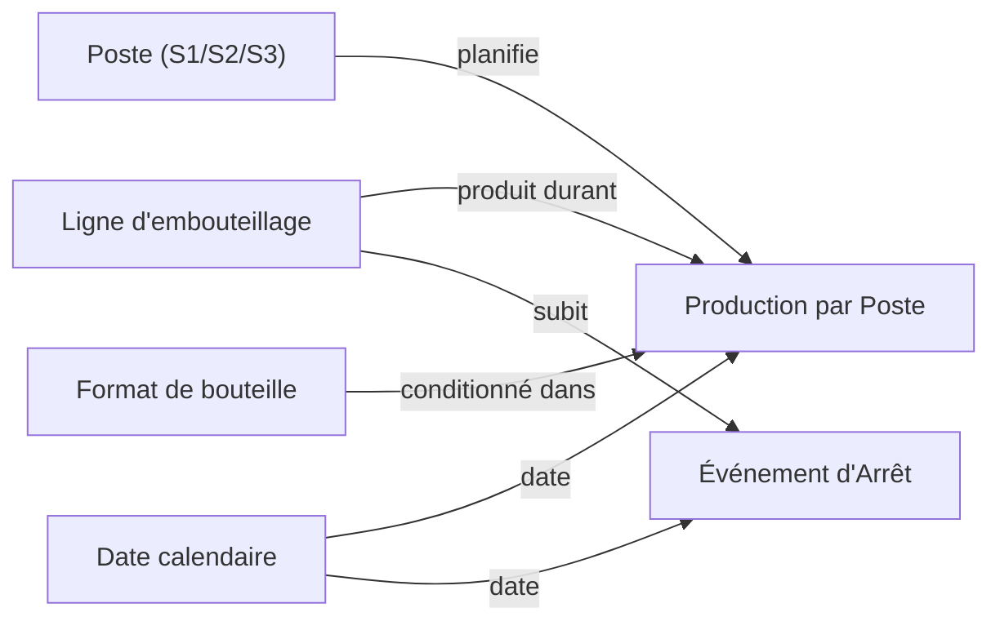

# Cours : Business Intelligence and Big Data Analysis (`01 31 0367 00`)

## Synthèse Académique & Technique — Cours 04 : Modélisation des Données, Schéma en Étoile Kimball & Introduction au SQL Analytique

**Langue :** Français (`FR`)  
**Enseignant :** Tomasz Kołodziejczyk (IFE, 2026)  
**Public :** 4e année B.Sc. Ingénierie (Gestion et Génie Industriel)  
**Durée de la séance :** `90 Minutes` *(Enchaîne directement sur le **Lab 05** aujourd'hui et prépare vos équipes au **Tutorial #2**)*  
**Contexte Pipeline (Architecture Médaillon) :** `1. Sources Brutes` → `2. Couche Bronze` → `3. Couche Silver` → **`4. Couche Gold (Entrepôt Dimensionnel)`** → `5. BI & Analytique`

---

## 0. Feuille de route de la séance & Fil conducteur industriel (`90 min`)

Au **Cours 03**, nous avons nettoyé les flux industriels bruts pour bâtir une **couche Silver** fiable. Aujourd'hui, nous franchissons le pas vers la **couche Gold** : transformer ces tables propres en un **Entrepôt de Données (Data Warehouse)** capable de répondre aux questions de la direction en quelques millisecondes — sans jamais doubler la capacité usine ni tromper les décideurs.

Nous suivrons **un seul fil conducteur industriel** du début à la fin — **EuroPack Beverage Bottling (Usine #1, Gdańsk)** — pour voir les *mêmes données d'atelier* passer du tableau blanc jusqu'aux requêtes **SQL DuckDB** en direct :

| Bloc | Créneau | Thème | Lien direct avec le Lab 05 d'aujourd'hui & le Tutorial #2 |
| :--- | :---: | :--- | :--- |
| **Bloc 1** | `00:00 – 00:25` *(25m)* | **Modélisation : Conceptuel → Logique → Physique** | Comment passer des questions métier au plan d'architecture (votre méthode exacte du **Tutorial #2** !). |
| **Bloc 2** | `00:25 – 00:35` *(10m)* | **Patterns d'Entrepôts de Données (DWH)** | Pourquoi la BI industrielle moderne associe **Silver Médaillon** et **Schéma en Étoile Kimball Gold**. |
| **Bloc 3** | `00:35 – 01:05` *(30m)* | **Plongée dans le Schéma en Étoile Kimball** | Démarche en 4 étapes, Granularité, Additivité, Clés de substitution & **Piège Fan-Out** (erreur `×31,9` !). |
| **Bloc 4** | `01:05 – 01:30` *(25m)* | **« SQL en langage clair » pour les Schémas en Étoile** | Lire et écrire `SELECT`, `WHERE`, `GROUP BY`, `INNER/LEFT JOIN` — tremplin immédiat vers le **Lab 05**. |

---

## 1. Bloc 1 (`00:00 – 00:25`) : De l'atelier à la base de données — Modèles Conceptuel, Logique & Physique

Avant d'écrire la moindre ligne de SQL, un ingénieur industriel trace un plan. On ne soude jamais un convoyeur sans dessin CAO ; de même, on ne charge jamais un Data Warehouse sans **trois niveaux progressifs de modélisation**.

```text
  NIVEAU 1 : CONCEPTUEL            NIVEAU 2 : LOGIQUE                NIVEAU 3 : PHYSIQUE
  (Direction / Métier)             (Architecte Données / DBML)       (Moteur DuckDB / Parquet)
  ─────────────────────            ───────────────────────────       ─────────────────────────
  « Quels concepts métier          « Quelles tables exactes,         « Quels types SQL précis,
   existent et comment              quelle granularité, clés PK/FK    clés de substitution et
   sont-ils liés ? »                et cardinalités (1:N) ? »         formats de stockage ? »
        │                                    │                                  │
        ▼                                    ▼                                  ▼
   Boîtes & Verbes                   Diagramme ERD / DBML              CREATE TABLE ... AS SELECT
  (Outil : Tableau blanc)           (Outil : dbdiagram.io)            (Outil : DuckDB + Parquet)
```

### 1.1 Niveau 1 — Le Modèle Conceptuel (*Ce qui compte pour le métier*)
* **Public :** Directeur d'usine (COO), Responsable Maintenance, Directeur Logistique — **zéro jargon informatique !**
* **Contient UNIQUEMENT :** Les grandes **Entités Métier** (noms) et leurs **Relations** (verbes). Aucun type de données, aucune clé technique, aucun `VARCHAR(50)`.
* **Exemple EuroPack Bottling :**
  * Une **Ligne d'embouteillage** *produit* des **Formats de bouteille** durant un **Poste de travail** à une **Date calendaire**.
  * Une **Ligne d'embouteillage** *subit* des **Arrêts machine** traités par une **Équipe de maintenance**.



> **Lien avec le Tutorial #2 :** Quand votre équipe modélisera **SmartPress**, **DataCo** ou **Nexis**, commencez toujours ici ! Si le directeur d'usine ne peut pas dire *"Oui, c'est exactement ainsi que tourne notre usine"*, corrigez le modèle avant d'ouvrir votre ordinateur.

### 1.2 Niveau 2 — Le Modèle Logique (*Quelles données existent — Clés Métier & Relations*)
* **Public :** Analystes BI, Experts Métier & Architectes Données (**indépendant de l'outil et du pattern DWH** — documente *quelles données existent* en termes métier avant de choisir entre 3FN, Data Vault ou Kimball !).
* **Ajoute quatre éléments essentiels (documentés en Diagramme ER + Dictionnaire de Données ISO dans le Tutorial #2) :**
  1. **Attributs métier :** ex. `bottled_units`, `rejected_units`, `downtime_min`, `hourly_operating_cost_eur`.
  2. **Clés Naturelles / Métier (`PK`) :** L'identifiant métier qui désigne de manière unique une entité réelle (ex. `line_id = 'LINE_B'`, `shift_code = 'S3'`, `format_id = 'PET_05'`, `log_id = 'STOP-021'`).
  3. **Relations & Clés Étrangères (`FK`) :** Liens entre événements opérationnels et entités de référence.
  4. **Cardinalités & Optionalité (`1:N` / `1:1` / `M:N`) :** Combien d'occurrences d'un côté correspondent à l'autre !
     * `Ligne d'embouteillage` (`1`) ───► (`N`) `Production par Poste` : *Une ligne réalise de nombreux postes, et chaque poste appartient obligatoirement à une seule ligne (barre `|`).*
     * **Signal d'alarme (`M:N`) :** Les relations plusieurs-à-plusieurs entre deux entités opérationnelles (ex. télémétrie 15 min reliée directement à plusieurs arrêts) sont la **cause n° 1 d'explosion silencieuse des KPIs** !

### 1.3 Niveau 3 — Le Modèle Physique (*Plan DBML de l'Entrepôt → Implémentation DuckDB*)
* **Public :** Architectes Données, Data Engineers & Développeurs BI.
* **Traduit le Modèle Logique dans une architecture d'entrepôt concrète (ici : Schéma en Étoile Kimball sous DuckDB) :**
  * **Plan Physique (`schema.dbml`) :** L'outil CAO de l'Architecte Données pour concevoir *comment* le Modèle Logique sera implémenté dans le Data Warehouse — choix du **Schéma en Étoile Kimball** (`Dim_*` & `Fact_*`), clés de substitution entières (`line_key [pk]`), types concrets (`integer`, `double`, `varchar`, `timestamp`) et clés étrangères obligatoires (`[not null, ref: > Dim_...]`).
  * **Moteur Physique (`europack_lab05.duckdb` + Parquet) :** Requêtes `CREATE TABLE` SQL, stockage Parquet Snappy et vues KPI gouvernées traduisant `schema.dbml` 1 pour 1.

### 1.4 Pourquoi écrire un DBML ? Le plan CAO de l'Architecte Données
On pose souvent la question : *« Quel est le lien entre Modèle Logique, Schéma en Étoile Kimball et DBML ? »* Voici les trois rôles bien distincts :
* **Modèle Logique** = *Quelles données métier existent* (attributs, clés naturelles, relations — compréhensible par le métier ; Diagramme ER + `data_dictionary_template.md`).
* **Schéma en Étoile Kimball** = *Le pattern d'architecture d'entrepôt* choisi par l'architecte (Faits + Dimensions Conformes + Clés de substitution — Blocs 2–3 !).
* **DBML (`schema.dbml`)** = *Le langage CAO de l'architecte* décrivant ce plan physique Kimball avant d'écrire le SQL dans DuckDB :
1. **Corriger les erreurs en 2 minutes au lieu de 2 heures :** Repérer une `Dim_Date` manquante, une flèche `1:N` inversée ou un ratio `oee_pct` non additif sur un schéma visuel prend quelques secondes — après 200 lignes de SQL, c'est beaucoup plus coûteux.
2. **Contrat d'équipe (Tutorial #2 → Labs 05–09) :** Relie votre Dictionnaire de Données Logique aux noms physiques exacts (`Dim_*`/`Fact_*`), clés de substitution et types *avant* d'écrire du code ou un dashboard.
3. **Traduction directe 1 pour 1 dans DuckDB :** Chaque bloc `Table Dim_Line { ... }` de `schema.dbml` devient une vraie table `CREATE TABLE Dim_Line AS ...` dans DuckDB — et la cohérence **`DBML == DuckDB`** est au cœur de l'évaluation du projet !
4. **Garantit les liens obligatoires (`NOT NULL`) :** Dans un schéma Kimball, chaque ligne de Fait appartient obligatoirement à une Date, un Poste, une Ligne et un Format valides — d'où `[not null, ref: > Dim_...]` (zéro clé orpheline ou nulle).

| Niveau de modèle | Question principale | Éléments clés | Livrable type | Où vous le construisez |
| :--- | :--- | :--- | :--- | :--- |
| **1. Conceptuel** | *Que se passe-t-il dans l'usine ?* | Entités métier (Noms) + Verbes | Croquis tableau blanc | **Tutorial #2** (Projet) |
| **2. Logique** | *Quelles données existent & comment sont-elles liées ?* | Attributs, Clés métier/naturelles, relations `1:N`/`M:N` | Diagramme ER + **Dictionnaire de données** | **Tutorial #2** (`data_dictionary_template.md`) |
| **3. Physique (Plan → Moteur)** | *Comment l'implémenter dans le DWH ?* | **Kimball** (`Dim_*`/`Fact_*`), clés de substitution, types, DDL & Parquet | **DBML (`schema.dbml`)** → **DuckDB** (`europack_lab05.duckdb`) | **Tutorial #2** & **Labs 05–06** |

---

## 2. Bloc 2 (`00:25 – 00:35`) : Patterns d'Entrepôts de Données (DWH) — Choisir la bonne architecture

Une fois la couche Silver propre, comment structurer la base analytique ? Quatre grands modèles dominent l'industrie. En tant que futurs ingénieurs en gestion et génie industriel, l'essentiel est de savoir **quand choisir chaque pattern** :

| Pattern | Principe central | Point fort | Limite principale | Cas d'usage idéal |
| :--- | :--- | :--- | :--- | :--- |
| **1. Inmon (3FN / Corporate Information Factory)** | Noyau d'entreprise normalisé en 3e forme normale (`3FN`) d'abord, puis datamarts métiers. | Élimine toute redondance ; forte gouvernance centralisée. | Long à déployer ; requêtes complexes (8–12 jointures) difficiles à lire pour le métier. | Grandes banques / télécoms très régulés avec de vastes équipes IT. |
| **2. Kimball (Schéma en Étoile Dimensionnel)** | Tables de **Faits** par processus métier entourées de **Dimensions** dénormalisées (`jointures en 1 saut`). | **Le plus intuitif & rapide à requêter** ; parfait pour les filtres Power BI / Tableau / Streamlit ; livraison incrémentale. | Exige une discipline stricte sur la **Granularité** et les **Dimensions Conformes**. | **BI industrielle, OEE, Supply Chain & tableaux de bord de direction (Notre couche Gold !).** |
| **3. Data Vault 2.0** | Sépare les données en **Hubs** (clés métier), **Links** (relations) et **Satellites** (historique). | Traçabilité d'audit totale face à de multiples ERP/MES évolutifs. | Trop de jointures pour la BI directe (nécessite quand même un schéma Kimball par-dessus !). | Couches d'intégration multi-usines soumises à des audits lourds. |
| **4. One Big Table (OBT) / Table Plate** | Pré-joint toutes les colonnes dans une seule grande table (souvent en Parquet). | Zéro jointure à l'exécution ; ultra-rapide pour un graphique isolé ou du Machine Learning. | Casse dès qu'il y a plusieurs granularités (production par poste + arrêts → fan-out !). | **Export BI Serving (Lab 07)** généré *depuis* les vues Gold gouvernées. |

> **Notre choix d'architecture industrielle (Médaillon + Kimball) :**  
> Nous utilisons **Médaillon (Bronze → Silver)** pour la traçabilité brute et les portes qualité, le **Schéma en Étoile Kimball** en **Gold (DuckDB)** comme source unique de vérité analytique, puis des **vues OBT** pour alimenter facilement nos cockpits.

---

## 3. Bloc 3 (`00:35 – 01:05`) : Plongée dans le Schéma en Étoile Kimball

Pourquoi parle-t-on de **Schéma en Étoile** ? Parce qu'une fois dessiné dans `dbdiagram.io`, une **Table de Faits** trône au centre et les **Tables de Dimensions** rayonnent autour — chaque requête métier n'exige qu'**une seule jointure `1:N` propre** !

```text
                      ┌──────────────┐
                      │   Dim_Date   │
                      │  (date_key)  │
                      └──────┬───────┘
                             │ 1:N
┌──────────────┐  1:N ┌──────┴──────────────────┐  N:1  ┌──────────────┐
│  Dim_Line    ├─────►│  Fact_Shift_Production  │◄──────┤  Dim_Shift   │
│  (line_key)  │      │  (bottled, rejected,    │       │ (shift_key)  │
└──────────────┘      │   planned/operating min)│       └──────────────┘
                      └──────┬──────────────────┘
                             │ N:1
                      ┌──────┴───────┐
                      │  Dim_Format  │
                      │ (format_key) │
                      └──────────────┘
```

### 3.1 Faits vs Dimensions : La règle « Mesurer vs Filtrer »
* **Tables de Faits = Les VERBES / ÉVÉNEMENTS (Que s'est-il passé ? Combien ?)**
  * Hautes et étroites (des milliers à des milliards de lignes).
  * Contiennent des **Clés Étrangères** (`date_key`, `line_key`, `shift_key`, `format_key`) + des **Mesures Numériques** (`bottled_units`, `rejected_units`, `downtime_min`, `downtime_cost_eur`).
* **Tables de Dimensions = Les NOMS / CONTEXTE (Qui ? Quoi ? Où ? Quand ? Pourquoi ?)**
  * Courtes et larges (de quelques lignes à quelques milliers — ex. `Dim_Line` = 4 lignes ; `Dim_Date` = 60 lignes).
  * Contiennent les **attributs descriptifs** utilisés pour **filtrer (`WHERE`)** et **regrouper (`GROUP BY`)** : `line_name`, `filler_type`, `packaging_material`, `is_weekend`, `shift_name`.

> [!TIP]
> **Pause & Sondage en direct #1 (2 min — À main levée !) :**  
> *Annoncez chaque champ d'EuroPack et demandez à la salle : **Mesure de FAIT** ou **Attribut de DIMENSION** ?*
> 1. `packaging_material` (`"Amber Glass 450g"`) → **Dimension (`Dim_Format`)** — sert à filtrer/regrouper !
> 2. `rejected_units` (`412` bouteilles) → **Fait (`Fact_Shift_Production`)** — mesure numérique d'un poste !
> 3. `hourly_operating_cost_eur` (`240,0 €/h`) → **Dimension (`Dim_Line`)** — propriété statique de la machine (utilisée ensuite pour *calculer* la mesure `downtime_cost_eur` !).
> 4. `downtime_min` (`120` min) → **Fait (`Fact_Stoppage_Events`)** — durée mesurée d'une panne !

### 3.2 La démarche Kimball en 4 étapes
À chaque conception d'un schéma en étoile (au Lab 05 aujourd'hui et au Tutorial #2 la semaine prochaine), respectez **ces 4 étapes dans l'ordre exact** :

1. **Étape 1 — Choisir le processus métier :** Une table de Faits par processus physique (ou granularité analytique).
   * EuroPack comporte **trois tables de Faits Gold** partageant exactement les mêmes Dimensions Conformes :
     * *(A) Télémétrie capteur atomique :* **`Fact_Telemetry_15min`** (`23 000` lignes — préserve chaque relevé automate 15 min : température, pression, cycles vanne !).
     * *(B) Production par poste pré-agrégée :* **`Fact_Shift_Production`** (`1 010` lignes — capacité proratisée `480,0 min` & OEE de direction).
     * *(C) Interventions d'arrêt machine :* **`Fact_Stoppage_Events`** (`289` lignes — tickets de panne enrichis des pics 2h avant arrêt).
2. **Étape 2 — Déclarer la granularité (ÉTAPE LA PLUS CRITIQUE !) :** Écrivez une phrase sans ambiguïté indiquant **ce que représente exactement une ligne**.
   * Granularité de `Fact_Telemetry_15min` *(Fait Atomique)* : *« Une ligne par **Relevé Automate 15 min × Ligne d'embouteillage**. »*
   * Granularité de `Fact_Shift_Production` *(Fait Agrégé)* : *« Une ligne par **Date calendaire × Poste × Ligne d'embouteillage × Format de bouteille**. »*
   * Granularité de `Fact_Stoppage_Events` *(Fait Événementiel)* : *« Une ligne par **Ticket d'arrêt maintenance (`log_id`)**. »*
   * **Règle d'or :** Ne mélangez jamais deux granularités différentes dans la même table de Faits !

#### Principe clé Kimball : Le confort analytique prime sur l'absence de redondance !
En bases transactionnelles (`3FN`), on évite toute duplication. En **OLAP Kimball**, le stockage ne coûte presque rien — **la vitesse analytique, la clarté et la richesse d'analyse priment** :

```text
  COUCHE SILVER (Entrée propre)         COUCHE GOLD (3 Tables de Faits sur Dimensions Conformes !)
  ─────────────────────────────         ──────────────────────────────────────────────────────────
  silver_telemetry.parquet     ──┬──►  1. Fact_Telemetry_15min (23 000 lignes — Fait Atomique)
  (23 000 relevés 15 min)        │        Courbes intra-poste 15 min, dérive thermique & ML !
                                 │
                                 └──►  2. Fact_Shift_Production (1 010 lignes — Fait Agrégé)
                                          OEE COO instantané, capacité exacte 480,0 min &
                                          moyennes procédé pondérées (via telemetry_readings) !

  silver_stoppages.parquet     ─────►  3. Fact_Stoppage_Events (289 lignes — Fait Événementiel)
                                          Pareto MTTR/MTBF + contexte pics d'usure 2h avant arrêt !
```

Une fois la couche Gold construite au Lab 06, **la BI et les KPIs lisent uniquement Gold — jamais Silver** — sans aucun compromis entre le génie procédé (détail 15 min) et la direction (OEE poste propre) !

3. **Étape 3 — Identifier les Dimensions :** Quels noms décrivent chaque ligne à cette granularité ?
   * `Dim_Date`, `Dim_Shift`, `Dim_Line` (partagées entre *les deux* faits = **Dimensions Conformes** !), plus `Dim_Format` (pour `Fact_Shift_Production`).
4. **Étape 4 — Identifier les Faits & vérifier leur additivité :** Quelles mesures numériques existent à cette granularité ?

### 3.3 Additivité des Faits & Le piège de la « Moyenne des Moyennes »
Tous les nombres ne s'agrègent pas de la même façon entre un poste et un mois entier :

| Type d'additivité | Définition | Exemple EuroPack | Règle d'agrégation SQL |
| :--- | :--- | :--- | :--- |
| **Additif** | Peut s'additionner librement sur *toutes* les dimensions (`Date`, `Line`, `Shift`, `Format`). | `bottled_units`, `rejected_units`, `downtime_min`, `downtime_cost_eur` | `SUM(colonne)` — la référence absolue ! |
| **Semi-additif** | Additionnable sur certaines dimensions (ex. lignes), **JAMAIS** dans le temps. | `valve_cycles_k` (compteur cumulé), niveau de stock | `AVG()` ou `MAX()` dans le temps ; jamais `SUM()` sur plusieurs jours ! |
| **Non-additif** | Ratios et pourcentages — ne **JAMAIS** sommer ni moyenner naïvement ! | `oee_pct`, `reject_rate_pct`, `MTTR` | **Stocker numérateur et dénominateur bruts** (`good_units`, `bottled_units`) et calculer **`SUM(good) / NULLIF(SUM(bottled), 0)`** à la requête ! |

* **Pourquoi `AVG(reject_rate_pct)` ment :**
  * Le poste A produit `10 000` bouteilles avec `100` rejets (`1,0 %`). Le poste B fait un essai de `100` bouteilles avec `50` rejets (`50,0 %`).
  * Moyenne naïve `AVG(reject_rate)` = **`25,5 %`** (complètement faux !).
  * Vrai ratio pondéré `SUM(rejected) / SUM(bottled)` = `150 / 10 100` = **`1,49 %`**.
* **Gérer les grandeurs physiques non additives (`avg_pressure_bar`, `avg_pasteurizer_temp_C`) :**
  * Une température ou une pression ne s'additionne jamais (`72 °C + 74 °C ≠ 146 °C`). Pour agréger proprement en Gold sans jamais revenir lire la couche Silver, stockez le compteur additif **`telemetry_readings`** à côté dans `Fact_Shift_Production`, puis calculez la moyenne pondérée exacte : `SUM(avg_pasteurizer_temp_C * telemetry_readings) / NULLIF(SUM(telemetry_readings), 0)` !

### 3.4 Clés de substitution, Dimensions Conformes & Pourquoi `Dim_Date` est indispensable
Pourquoi les Dimensions utilisent-elles des **clés entières de substitution** (`line_key = 1, 2, 3, 4`) plutôt que les codes texte de l'ERP (`"LINE_A"`, `"LN-B"`) ?
1. **Vitesse & Compacité :** Joindre des entiers sur 4 octets (`line_key = 2`) est nettement plus rapide et léger que comparer du texte sur des millions de lignes.
2. **Immunité face aux changements ERP :** Si l'ERP renomme `"LINE_B"` en `"FILLER_M2"` l'an prochain, `line_key = 2` reste stable — l'historique reste intact.
3. **Dimensions Conformes (Le ciment de la BI) :** Comme `Fact_Shift_Production` et `Fact_Stoppage_Events` pointent toutes deux vers les **mêmes tables `Dim_Date`, `Dim_Shift` et `Dim_Line`**, un seul filtre de tableau de bord (`Line = LINE_B`) filtre simultanément la production ET les pannes !

#### Pourquoi créer une table `Dim_Date` alors qu'on a déjà une colonne date ?
C'est la question n° 1 quand on bâtit son premier entrepôt ! Garder une simple colonne `2026-10-15` dans la table de Faits ne suffit **jamais** en BI industrielle pour **4 raisons concrètes** :
1. **Attributs métier précalculés :** Les décideurs veulent filtrer par `is_weekend`, `day_of_week`, `month_name`, `quarter`, jours fériés ou arrêts planifiés — sans réécrire des formules SQL complexes dans chaque graphique !
2. **Séries temporelles sans trous :** Si une ligne est fermée le dimanche, la table de Faits contient **zéro ligne** ce jour-là. Une table `Dim_Date` continue garantit des courbes et moyennes mobiles 7 jours sans jours manquants.
3. **Un calendrier unique pour plusieurs tables de Faits :** `Fact_Shift_Production` et `Fact_Stoppage_Events` pointent toutes deux vers `Dim_Date.date_key`. Filtrer *« Octobre 2026 »* filtre **à la fois** la production et les pannes !
4. **Pourquoi une clé entière `AAAAMMJJ` (`20261001`) surpasse une simple colonne `DATE` :**
   * **Lisible & triable naturellement :** Contrairement à une clé opaque (`1, 2, 3`), `20261015` se lit d'un coup d'œil et se trie chronologiquement (`20261001 < 20261101`) sans même joindre `Dim_Date`.
   * **Gère les dates « Inconnues / En attente » sans `NULL` :** Une colonne `DATE` oblige à mettre `NULL` pour une livraison non expédiée (cassant les clés `NOT NULL`). Un entier autorise des lignes sentinelles (`-1` = *Inconnu*, `99991231` = *À venir*).
   * **Zéro piège de fuseau horaire ou de format :** Élimine les confusions `MM/JJ` vs `JJ/MM`, numéros de série Excel et décalages UTC entre Python, DuckDB et la BI — tout en offrant des jointures ultra-rapides sur 4 octets.

### 3.5 Le désastre BI n° 1 : Le piège Fan-Out (Preuve réelle sur EuroPack !)
Que se passe-t-il si un analyste saute la modélisation dimensionnelle et joint directement la **télémétrie 15 min (`23 000` lignes)** aux **journaux d'arrêts (`289` tickets)** sur `(date, shift, line)` ?

```text
  télémétrie (32 lignes pour UN poste de 8h)    arrêts (1 panne = 120 min)
  ┌───────────────────────────┐                 ┌───────────────────────────────┐
  │ 22:00  LINE_B  1 200 btl  │───┐             │                               │
  │ 22:15  LINE_B  1 180 btl  │───┼────────────►│ STOP-021  LINE_B  120 min     │
  │ ... (30 autres lignes !)  │───┘             │                               │
  └───────────────────────────┘                 └───────────────────────────────┘
                                  RÉSULTAT :
   L'unique panne de 120 min est dupliquée sur TOUTES les 32 lignes de télémétrie !
   SUM(downtime_min) = 32 × 120 = 3 840 minutes (64 heures de panne dans un poste de 8h !!)
```

> [!TIP]
> **Pause & Sondage en direct #2 (2 min — Devinez l'explosion !) :**  
> *Sur les 60 jours d'EuroPack, le vrai total d'arrêts imprévus est de **`22 260 minutes`** (371 heures). Si l'on fait un `JOIN` SQL naïf entre la télémétrie 15 min et les arrêts, puis qu'on demande `SUM(downtime_min)`, que renvoie SQL ?*  
> *A) `22 260 min` &nbsp;|&nbsp; B) `~45 000 min` &nbsp;|&nbsp; C) `~220 000 min` &nbsp;|&nbsp; D) **`710 400 min` (inflation ×31,9 — 1,35 an de pannes sur 60 jours !)** *  
> **Révélation :** **D (`710 400 min`) !** Vous allez provoquer puis corriger ce piège en direct au **Lab 05** aujourd'hui !

**Le remède :** Toujours aligner les granularités *avant* de joindre — garder une table de Faits par granularité (`Fact_Shift_Production` vs `Fact_Stoppage_Events`), proratiser le temps de poste (`480,0 min × time_share`), et pré-agréger chaque table de Faits dans sa propre CTE avant de croiser les indicateurs !

---

## 4. Bloc 4 (`01:05 – 01:30`) : « SQL en langage clair » — Votre passerelle vers DuckDB & le Lab 05

Dans les Labs 02–04, Pandas demandait de manipuler des crochets Python, des index et des chaînage de méthodes. Bonne nouvelle : **SQL (Structured Query Language)** est déclaratif — vous dites simplement à **DuckDB** *quelle réponse métier vous voulez*, pas *comment boucler sur les lignes*.

### 4.1 L'aide-mémoire SQL en 7 clauses (Ordre d'écriture vs Ordre d'exécution)
SQL se lit de haut en bas comme une phrase métier, tout en gardant en tête l'**ordre logique** dans lequel DuckDB l'exécute :

```sql
SELECT   l.line_name,                                 -- 5. CHOISIR colonnes & KPIs à afficher
         COUNT(*)                       AS stoppages,
         SUM(s.downtime_min)            AS total_min,
         ROUND(AVG(s.downtime_min), 1)  AS avg_mttr_min
FROM     stg_stoppages s                              -- 1. PARTIR de la table principale (alias 's')
JOIN     stg_lines l                                  -- 2. RATTACHER une table de référence (alias 'l')
  ON     s.line_code = l.line_id                      --    sur leurs colonnes clés communes
WHERE    s.stoppage_type = 'Unplanned'                -- 3. FILTRER les lignes brutes AVANT regroupement
GROUP BY l.line_name                                  -- 4. REGROUPER en 1 ligne par machine
HAVING   COUNT(*) > 40                                -- 6. FILTRER les groupes APRÈS SUM/COUNT
ORDER BY total_min DESC                               -- 7. TRIER du plus grand au plus petit
LIMIT    5;                                           -- 8. GARDER le Top 5
```

| Clause SQL | Sens en français simple | Équivalent Excel | Piège classique à éviter |
| :--- | :--- | :--- | :--- |
| **`SELECT`** | Quelles colonnes ou formules afficher | Valeurs du TCD | Toute colonne non agrégée du `SELECT` doit être dans `GROUP BY`. |
| **`FROM`** | Quelle table contient les lignes | Onglet source | Donnez des alias courts (`s`, `l`) pour alléger la lecture. |
| **`JOIN ... ON`** | Chercher la correspondance dans une autre table | `RECHERCHEX` / `RECHERCHEV` | Vérifiez toujours la cardinalité (`1:N`) contre le Fan-Out ! |
| **`WHERE`** | Garder uniquement les lignes qui vérifient un critère | Filtre automatique | Exécuté *avant* `GROUP BY` — impossible d'y mettre `SUM()` ou `COUNT()` ! |
| **`GROUP BY`** | Regrouper par catégorie (dimensions) | Zone « Lignes » du TCD | Définit la granularité de votre résultat. |
| **`HAVING`** | Filtrer les *groupes résumés* | Filtre sur valeurs du TCD | Exécuté *après* `GROUP BY` — c'est **ici** que va `COUNT(*) > 20` ! |
| **`ORDER BY` / `LIMIT`** | Trier et afficher le Top N | Tri Z→A + Top 5 | Par défaut `ASC` (croissant) ; ajoutez `DESC` pour le plus grand en premier. |

### 4.2 Panorama des types de `JOIN` SQL — Choisir la bonne jointure
En BI industrielle, une mauvaise jointure **supprime silencieusement des postes sains** ou **multiplie les lignes**. Choisissez toujours consciemment parmi les 4 jointures SQL standard :

| Type de `JOIN` | Modèle mental | Quelles lignes survivent ? | Cas d'usage en BI industrielle |
| :--- | :---: | :--- | :--- |
| **`INNER JOIN`** | `A ∩ B` | **Uniquement les correspondances** des deux côtés. | Enrichir les pannes avec le coût horaire machine (`stg_stoppages INNER JOIN stg_lines`). |
| **`LEFT JOIN`** | `TOUT A + (A ∩ B)` | **Toutes les lignes de gauche** + colonnes de droite (`NULL` si pas de correspondance). | Conserver les **720 postes planifiés**, y compris les 510 sans panne (`COALESCE(down_min, 0)` !). |
| **`RIGHT JOIN`** | `(A ∩ B) + TOUT B` | Symétrique du `LEFT JOIN` (garde toute la table de droite). | Rarement utilisé — on préfère écrire `LEFT JOIN` en plaçant la table principale à gauche ! |
| **`FULL OUTER JOIN`** | `A ∪ B` | **Toutes les lignes des deux côtés** (`NULL` côté manquant). | Audits de réconciliation Qualité (ex. comparer commandes ERP vs expéditions WMS). |

> **Réflexe de lecture métier :** Placez toujours l'entité métier de départ à **GAUCHE** (`FROM Dim_Format f LEFT JOIN ...`) : cela reflète la question métier (*« Je pars de mes 3 formats de bouteille, puis j'y rattache leurs volumes de production »*).

```text
  INNER JOIN (Intersection uniquement)        LEFT JOIN (Garde TOUTES les lignes de gauche)
  ────────────────────────────────────        ─────────────────────────────────────────────
     [Tous les postes] ∩ [Arrêts]                [TOUS les postes] + [Arrêts] éventuels
     Uniquement les postes AVEC panne            Postes sans panne = NULL -> COALESCE(..., 0)
```

> [!TIP]
> **Pause & Sondage en direct #3 (2 min — Prédisez le nombre de lignes !) :**  
> *EuroPack a exploité **720 lignes-postes** sur 60 jours (`60 jours × 3 postes × 4 lignes`). Parmi ces 720 postes, **210 postes** ont connu au moins un arrêt imprévu, et **510 postes** ont tourné parfaitement sans aucun arrêt.*
> * Si l'on joint `all_line_shifts` (à gauche) à `shift_stoppages` (à droite) :
>   * Combien de lignes renvoie un **`INNER JOIN`** ? → **`210` lignes** *(masquant silencieusement 510 postes sains et gonflant la durée moyenne d'arrêt par poste de ×3,4 !)*
>   * Combien de lignes renvoie un **`LEFT JOIN`** ? → **`720` lignes** *(utilisez `COALESCE(down_min, 0)` pour remplacer `NULL` par `0` min !)*

### 4.3 Découvrez DuckDB : Votre moteur analytique embarqué (`Zéro serveur à installer !`)
Pourquoi utiliser **DuckDB** plutôt que d'installer un lourd serveur PostgreSQL ou Oracle ?
* **OLAP embarqué sans infrastructure :** Un simple fichier (`europack_lab05.duckdb`) dans votre dossier projet — comme SQLite, mais conçu dès l'origine en **exécution vectorisée en colonnes** pour l'analytique.
* **Lecture Parquet native :** Interrogez directement les fichiers Parquet Silver en une ligne sans étape d'import :
  ```sql
  SELECT bottle_format, SUM(bottled_units) AS total_bottles
  FROM read_parquet('.../silver_telemetry.parquet')
  GROUP BY bottle_format;
  ```
* **Création de tables instantanée (`CTAS`) :** Construisez vos tables de Dimensions Gold proprement via `CREATE OR REPLACE TABLE Dim_Line AS SELECT ...` !

---

## 5. Passerelle vers le Lab 05 d'aujourd'hui & la suite du cours

| Séance | Ce que vous allez réaliser | Lien direct avec le Cours 04 |
| :--- | :--- | :--- |
| **Aujourd'hui — Lab 05** *(Juste après ce cours !)* | 1. **Réparer un schéma DBML EuroPack cassé** en direct sur `dbdiagram.io`<br>2. Charger les Parquets Silver dans **DuckDB**<br>3. Résoudre les **missions Détective Usine (SQL & JOINs)** (et déclencher le Fan-Out à `710 400 min` en direct !)<br>4. Construire vos **4 Dimensions Conformes** (`Dim_Line`, `Dim_Shift`, `Dim_Format`, `Dim_Date`) | Met en pratique les Blocs 1, 3 & 4 sans friction Python ! |
| **À venir — Tutorial #2** *(Votre cas d'étude en équipe)* | Concevoir le **Modèle Conceptuel → Modèle Logique → Schéma DBML** + Règles Qualité DAMA pour votre étude de cas (`SmartPress`, `DataCo` ou `Nexis`). | Applique les Blocs 1 & 3 (Kimball en 4 étapes) à votre projet noté. |
| **Suivant — Lab 06** *(Faits Gold & Vues KPI)* | Reprendre vos Dimensions de `europack_lab05.duckdb`, charger les deux **tables de Faits** (`Fact_Stoppage_Events`, `Fact_Shift_Production`), et publier les **5 vues KPI gouvernées** qui révèlent les goulots cachés d'EuroPack ! | Finalise l'entrepôt Gold prêt pour Plotly & Streamlit (Labs 07–09). |
